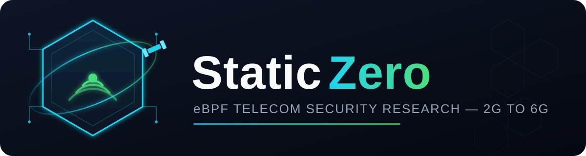

<div align="center">



### Kernel-level telecom security research — from 2G to the 6G horizon

[](https://github.com/yasindce1998/StaticZero/actions/workflows/ci.yml)
[](https://github.com/yasindce1998/StaticZero/actions/workflows/release.yml)
[](https://github.com/yasindce1998/StaticZero/releases/latest)
[](LICENSE)
[](https://www.rust-lang.org/)
[](https://ebpf.io/)

**StaticZero** intercepts, analyzes, and detects attacks across cellular,
satellite, and short-range protocols — at the Linux kernel level, where the
packets actually are. One eBPF-native framework covering twenty-five-plus
radio domains from GSM to Galileo OSNMA, Wi-Fi 7 MLO, satellite direct-to-cell,
and the 6G horizon — with a cross-layer correlation engine that turns
individual alerts into compound threat intelligence.

| &nbsp; | &nbsp; | &nbsp; | &nbsp; | &nbsp; |
|:---:|:---:|:---:|:---:|:---:|
| **112** offense features | **55** defense modules | **27** threat categories | **9** shipped tools | **127** tests |

[Quick start](#quick-start) · [Toolbelt](#the-toolbelt) · [Capability catalogs](#capability-catalogs) · [Docs](#documentation)

</div>

> ⚠️ **Research/educational purposes only.** Unauthorized interception of
> telecommunications is illegal in most jurisdictions. StaticZero is a
> research catalog and lab framework — see the
> [implementation status](#capability-catalogs) for exactly what is
> validated versus cataloged.

---

## Why StaticZero

**🔬 eBPF-native, kernel-level telemetry.** Kprobes, XDP, TC classifiers, and
tracepoints hook the exact kernel paths telecom traffic traverses — modem
serial, QMI/mbim rx fixups, GTP tunnels, SCTP signaling — with CO-RE
portability across kernels 5.15+.

**📡 The widest protocol coverage available in one framework.** From 2G/SS7
through 5G-A SBI and O-RAN fronthaul to Wi-Fi 7 MLO key separation, UWB
802.15.4z ranging, Galileo OSNMA authentication, satellite direct-to-cell,
Matter, Ambient IoT, DECT-2020 NR — and the 6G attack surface (AI-RAN
adversarial ML, RIS, PQC downgrades, ISAC) before the standard even lands.

**🧠 A correlation engine, not a log printer.** Alerts from every module feed
one engine that reasons across seven protocol layers: a spoofed
direct-to-cell satellite cell plus an IMSI-catcher pattern becomes a
*satellite-grade IMSI catching* threat at 0.95 confidence — compound attacks
single-module detection misses.

**✅ Proven on real kernels, not slides.** CI runs the actual binaries against
real Linux kernels: BPF verifier acceptance, live kprobe and XDP attachment,
the tool-adapter pipeline end-to-end, and ring-buffer event delivery —
[see the smoke suites](#proven-on-real-kernels).

## Coverage at a glance

| Domain | Offense | Defense |
|---|---|---|
| Cellular 2G / 3G / 4G / 5G / 5G-Advanced (NAS, GTP, SS7, Diameter, SBI, slicing) | F89–F120 | Modules 16–32 |
| 6G horizon — AI-RAN, RIS, THz, PQC, network-of-networks, ISAC | F195–F200 | Modules 66–70 |
| Satellite, NTN & direct-to-cell — DVB-S2, Iridium, Starlink, GNSS, LEO PNT, OSNMA, D2C | F121–F134, F180–F184 | Modules 33–39, 61–63, 68 |
| Wi-Fi 802.11 → Wi-Fi 8 — WPA3, MLO, AFC, OFDMA, 802.11bf sensing, MAPC, HaLow | F151–F155, F173–F179 | Modules 46–47, 56, 64, 69 |
| Bluetooth / BLE / BT 6.0 / UWB secure ranging / Auracast | F139–F142, F185–F188 | Modules 42, 57 |
| IoT radios — Zigbee, Z-Wave, Thread, LoRaWAN, NB-IoT, Matter, Ambient IoT, DECT-2020 NR | F143–F150, F189–F192 | Modules 43–45, 58–60 |
| Aviation, maritime & rail — ADS-B, ACARS, AIS, FRMCS, LDACS | F131–F132, F171–F172, F193–F194 | Modules 38, 55, 65 |
| Public safety & broadcast — TETRA, P25, POCSAG/FLEX, RDS/DAB+, EAS/WEA | F135–F138, F161–F166 | Modules 40–41, 50–52 |
| O-RAN — eCPRI fronthaul, F1/CU-DU split, near-RT RIC | F167–F170 | Modules 53–54 |
| Vehicles & drones — RKE/RollJam, MAVLink, DroneID, FPV | F156–F160 | Modules 48–49 |

## Quick start

Grab a [release](https://github.com/yasindce1998/StaticZero/releases/latest) —
ONE multi-call binary (~12 MB, `staticzero-linux-amd64` /
`staticzero-linux-arm64`, self-contained with embedded eBPF) that runs the
defense engine, the offense loader, and every tool as subcommands — or build
from source:

```bash
cargo xtask build-ebpf --release && cargo build --release -p staticzero --features ebpf-bin
```

```bash
# Inspect what will attach on this kernel — read-only, no privileges needed
staticzero defense --doctor --all

# Run the defense engine (authorized lab only)
sudo staticzero defense --all

# Feed live tool verdicts into the correlation engine (Modules 56/66/67)
staticzero 6g-sim generate --scenario ai-ran-tamper | staticzero 6g-sim analyze \
  | sudo staticzero defense --modules 66,67 --tool-input airan=- --tool-input pqc=-

# Run the offense loader (authorized testing only). Missing kernel hook
# points and interface conflicts disable one feature, never the loader.
sudo staticzero offense --enable-telecom --gtp-iface gtp0
```

## The toolbelt

| Tool | What it does |
|---|---|
| `staticzero defense` | Detection engine: eBPF probes + userspace tool adapters + correlation, with HTTP API and JSON/SIEM output |
| `staticzero offense` | eBPF offense loader for authorized red-team research (112 features) |
| `staticzero osnma-verify` | **Galileo OSNMA cryptographic spoofing detection** — TESLA key chains and MACs with in-tree HMAC-SHA256 |
| `staticzero d2c-monitor` | Flags **spoofed satellite cells** (Starlink D2C / AST / Skylo) by physics: timing advance, doppler, ephemeris |
| `staticzero mlo-analyzer` | Detects **Wi-Fi 7 MLO attacks**: link desync, key separation abuse, AKM mismatch, flapping |
| `staticzero 6g-sim` | 6G control-plane trace analyzer + scenario generator (AI-RAN integrity, PQC downgrade, credential crossing) |
| `staticzero sdr-bridge` | Hardware-abstracted SDR control (HackRF, bladeRF, USRP, RTL-SDR, LimeSDR) with a JSON API |
| `staticzero modem-firmware` | Baseband firmware analyzer |
| `staticzero protocol-correlator` | Cross-layer protocol correlation over captured traces |

All of the above ship as **one multi-call binary**: `staticzero <subcommand>`.
Legacy names still work via symlinks/argv[0] (busybox-style) — a symlink named
`staticzero-defense` routes to the `defense` subcommand, so existing scripts
keep working against the single downloaded file.

Protocol dissectors included: **PFCP** (TS 29.244), **NGAP** (TS 38.413),
**XnAP** (TS 38.423), **E2AP** (O-RAN.WG3), **F1AP** (TS 38.470/38.473).

## Proven on real kernels

Every claim about execution is backed by a smoke suite that CI runs on real
Linux runners — not unit-test mocks:

- **Defense engine**: real eBPF object load, tracepoint attachment, tool
  verdicts streamed through the live pipeline, compound threats
  (`AiRanCompromise`) surfacing in JSON output —
  [`scripts/tool_adapter_smoke.sh`](scripts/tool_adapter_smoke.sh)
- **Offense loader**: kprobes attached to `tcp_sendmsg` via real
  `bpf_link_create`, XDP programs attached to live interfaces, crafted GTP-U
  packets through the kernel datapath — [`scripts/offense_smoke.sh`](scripts/offense_smoke.sh)
- **Passive defense + real modem nodes** — [`scripts/defense_smoke.sh`](scripts/defense_smoke.sh)
- **SDR TX pipeline** (offline + cabled-hardware stages) — [`scripts/sdr_tx_smoke.sh`](scripts/sdr_tx_smoke.sh)

Details and scope: [LAB_SMOKE_TESTS.md](docs/LAB_SMOKE_TESTS.md) ·
[DEFENSE_VALIDATION.md](docs/DEFENSE_VALIDATION.md).

## Correlation engine

Cross-layer protocol correlation detects complex attack chains that single-module detection would miss. The `TelecomCorrelationEngine` ingests alerts from all modules and identifies compound threats across seven protocol layers (Radio, NAS, Transport, Signaling, Core, SBI, Satellite).

Threat categories: IMSI Catching, MitM, Protocol Downgrade, Signaling Abuse, Toll Fraud, Location Tracking, Data Interception, Service Denial, Slice Escape, Roaming Exploit, SBI Compromise, Handover Hijack, RAN Sharing Breach, Signaling Storm, Identity Exposure, Satellite Link Hijack, GNSS Spoofing, Beacon Falsification, Terminal Compromise, WiFi Rogue AP, Fronthaul Compromise, AIS Spoofing, Secure Ranging Spoofing, D2C Cell Spoofing, Smart Home Compromise, AI-RAN Compromise, PQC Downgrade.

Satellite-specific correlation patterns:
- DVB-S2 anomaly + VSAT integrity failure → coordinated transponder takeover
- GNSS spoofing + ADS-B injection → aviation-targeted multi-vector attack
- Starlink auth + LEO signaling anomaly → terminal impersonation chain
- NTN timing divergence + NAS replay → satellite-terrestrial positioning attack

RF protocol domain correlation patterns:
- WiFi deauth flood + WPA3/FT integrity failure → rogue AP / evil twin attack
- eCPRI fronthaul anomaly + RIC security violation → coordinated O-RAN compromise (confidence 0.93, severity 5)
- AIS physics violation + GNSS spoofing → maritime position falsification (confidence 0.94, severity 5)

Next-generation wireless correlation patterns:
- D2C cell spoof + GNSS authentication failure → spoofed satellite cell / D2C impersonation (confidence 0.92, severity 5)
- D2C cell spoof + IMSI catcher → satellite-grade IMSI catching (confidence 0.95, severity 5)
- LEO PNT anomaly + OSNMA failure → multi-constellation PNT spoofing (confidence 0.93, severity 5)
- Matter commissioning abuse + Ambient IoT/DECT-2020 anomaly → smart home takeover chain (confidence 0.88, severity 4)
- MLO integrity failure + WPA3 integrity failure → Wi-Fi 7 MLO evil twin (confidence 0.93, severity 4)
- AI-RAN model tampering + PQC downgrade → 6G control plane compromise (confidence 0.90, severity 5)
- Secure ranging manipulation + RKE jamming → vehicle digital key theft chain (confidence 0.91, severity 4)

## Capability catalogs

> **Implementation status (read this).** The tables below are a research
> catalog, not proof of working live interception/detection. Defense Module
> 22 has an experimental passive `openat` adapter; Modules 56, 61, 62, 66,
> 67, and 70 have validated userspace tool adapters (mlo-analyzer /
> d2c-monitor / osnma-verify / 6g-sim verdict streams via `--tool-input`);
> the remaining modules (16–21, 23–55, 57–60, and 63–69) currently lack
> validated attachment adapters and are reported as unsupported by the
> loader. SDR hardware methods also include scaffolding. Lab-tier smoke
> tests cover offensive kprobe attachment, XDP/TC traffic-path probes, real
> modem device nodes, and the sdr-bridge TX pipeline — see
> [lab smoke tests](docs/LAB_SMOKE_TESTS.md) and
> [defense validation](docs/DEFENSE_VALIDATION.md) for scope and limitations.
> Next-generation features (F173–F200, Modules 56–70) catalog emerging
> standards; see [docs/NEXTGEN_RESEARCH.md](docs/NEXTGEN_RESEARCH.md) for the
> research basis and standards status.

<details>
<summary><b>📖 Offensive capabilities — 112 features (F89–F200)</b></summary>

## Offensive Capabilities (F89–F200)

### Core Telecom Interception (F89–F100)

| # | Feature | Hook Point | Target |
|---|---------|-----------|--------|
| 89 | AT Command Injection | kprobe: `tty_write` | 2G/3G/4G modem serial |
| 90 | Baseband Exploitation | kprobe: `usb_submit_urb` | USB bulk to baseband |
| 91 | SIM Data Extraction | kprobe: `vfs_read` | APDU filesystem |
| 92 | IMSI Interception | kprobe: `qmi_wwan_rx_fixup` | NAS Identity/Attach |
| 93 | Protocol Downgrade | TC classifier | TAU Reject (5G/4G→2G) |
| 94 | GTP Tunnel Hijacking | XDP on GTP iface | TEID manipulation |
| 95 | SS7 MAP Injection | TC (SCTP:2905) | SendRoutingInfo/UpdateLocation |
| 96 | Diameter AVP Manipulation | TC (SCTP/TCP:3868) | S6a/S6b AVPs |
| 97 | RRC Connection Redirect | kprobe: `tty_write` | RRCConnectionRelease |
| 98 | NAS Message Interception | kprobe: `qmi_wwan_rx_fixup` | Pre-encryption NAS PDUs |
| 99 | 5G SUPI De-concealment | kprobe: `ecies_decrypt` | SUCI→SUPI recovery |
| 100 | 5G N2 Interface Injection | TC (SCTP:38412) | NGAP on AMF↔gNB |

### Advanced Telecom (F101–F108)

| # | Feature | Description |
|---|---------|-------------|
| 101 | VoLTE/VoNR Interception | SIP/SDP manipulation, RTP/SRTP key extraction, ReVoLTE |
| 102 | eSIM Provisioning Attack | SM-DP+ intercept, BPP injection, EID tracking |
| 103 | Network Slicing Exploit | S-NSSAI spoofing, cross-slice injection, UPF escape |
| 104 | WiFi Calling Exploitation | ePDG MitM, IKEv2/EAP-AKA' intercept, SWu hijack |
| 105 | Lawful Intercept Abuse | ADMF provisioning, IRI/CC redirect, warrant manipulation |
| 106 | Femtocell Exploitation | HeNB IPsec extraction, local RRC MitM, CSG spoofing |
| 107 | SUPL/Location Spoofing | SUPL SET forge, ULP falsification, A-GPS injection |
| 108 | Roaming/IPX Pivoting | GRX/IPX route injection, VPLMN impersonation |

### 5G Advanced Exploitation (F109–F120)

| # | Feature | Hook Point | Target |
|---|---------|-----------|--------|
| 109 | PBCH/SIB Broadcast Spoofing | kprobe: `tty_write` | MIB/SIB injection for fake cell selection |
| 110 | RRC Measurement Manipulation | kprobe: `qmi_wwan_rx_fixup` | Tamper RSRP/RSRQ to influence handover |
| 111 | Handover Hijacking | TC (SCTP:38412/36422) | NGAP/X2AP handover command injection |
| 112 | HTTP/2 SBI Exploitation | TC (ports 7777–7780) | NF-to-NF service API manipulation |
| 113 | NRF/AUSF/UDM API Abuse | TC (port 7778) | Rogue NF registration, discovery abuse |
| 114 | OAuth2 Token Theft | kprobe: `tcp_sendmsg` | Bearer tokens between Network Functions |
| 115 | Jamming Detection Evasion | XDP on SDR iface | Anti-detection waveform patterns |
| 116 | MIMO Beamforming Fingerprint | kprobe: `qmi_wwan_rx_fixup` | CSI-RS/SSB beam pattern extraction |
| 117 | Sidelink PC5/V2X Exploit | TC (UDP:38472) | ProSe/C-V2X L2 injection and tracking |
| 118 | 5G-AKA Protocol Downgrade | kprobe: `tcp_sendmsg` | Force 5G-AKA → EAP-AKA' fallback |
| 119 | SUCI Replay Attack | kprobe: `tcp_sendmsg` | Replay SUCI for cross-session tracking |
| 120 | ARPF Key Extraction | kprobe: `tcp_sendmsg` | Probe UDM/ARPF for auth vectors/keys |

### Satellite Communications (F121–F134)

| # | Feature | Hook Point | Target |
|---|---------|-----------|--------|
| 121 | DVB-S2 Downlink Interception | kprobe: `dvb_dmx_swfilter_packets` | Broadcast TS capture, BISS key patterns |
| 122 | Transponder Hijack Injection | TC on sat-iface | Spoofed PLHeader, carrier-ID manipulation |
| 123 | NTN Timing Advance Exploitation | kprobe: `tcp_sendmsg` | NR-NTN TA pre-compensation exploit |
| 124 | NTN-5G Core Gateway Injection | TC on sat-iface | NGAP injection via NTN feeder link |
| 125 | Iridium L-Band Frame Capture | kprobe: `sdr_rx_callback` | 1616–1626.5 MHz burst decode |
| 126 | LEO Constellation Signaling Injection | TC on sat-iface | Globalstar CDMA / Thuraya GMR-1 |
| 127 | VSAT Terminal Firmware Extraction | kprobe: `usb_submit_urb` | Hughes/iDirect/Newtec ACM tables |
| 128 | SCPC Carrier Manipulation | TC on sat-iface | DVB-RCS2 return channel, MF-TDMA slot |
| 129 | Starlink Dishy Auth Probe | kprobe: `tcp_sendmsg` | gRPC session tokens, firmware channel |
| 130 | ISL Laser Link Fingerprint | XDP on sat-iface | Inter-satellite laser timing metadata |
| 131 | ADS-B/ACARS Frame Injection | TC on sat-iface | Mode-S ES (1090 MHz), VHF data link |
| 132 | COSPAS-SARSAT Beacon Spoofing | kprobe: `sdr_rx_callback` | 406 MHz PLB/ELT hex ID spoofing |
| 133 | GPS L1 C/A Code Spoofing | XDP on SDR iface | L1 1575.42 MHz PRN code replicas |
| 134 | Multi-Constellation L5/E5 Spoofing | XDP on SDR iface | GPS L5 + Galileo E5a/b + BeiDou B2a |

### TETRA/P25 Public Safety LMR (F135–F138)

| # | Feature | Hook Point | Target |
|---|---------|-----------|--------|
| 135 | TETRA Air Interface Intercept | kprobe: `sdr_rx_callback` | π/4-DQPSK bursts, TEA1 backdoor (CVE-2022-24400) |
| 136 | TETRA Encryption Downgrade | TC classifier | SYSINFO encryption indicator → SCK/DCK fallback |
| 137 | P25 Control Channel Harvest | kprobe: `sdr_rx_callback` | Phase I/II trunking, TGID/WACN/NAC mapping |
| 138 | P25 IMBE Voice Interception | XDP on SDR iface | Unencrypted IMBE voice frames |

### Bluetooth/BLE (F139–F142)

| # | Feature | Hook Point | Target |
|---|---------|-----------|--------|
| 139 | BLE GATT Enumeration | kprobe: `hci_send_frame` | Service/characteristic discovery dumps |
| 140 | BLE Pairing Downgrade | kprobe: `smp_send_cmd` | LE Secure Connections → LE Legacy |
| 141 | BlueBorne-style RCE Probe | kprobe: `l2cap_recv_frame` | Malformed L2CAP PDUs |
| 142 | BLE Advertisement Spoofing | TC classifier | iBeacon/Eddystone impersonation |

### Zigbee/Z-Wave/Thread (F143–F145)

| # | Feature | Hook Point | Target |
|---|---------|-----------|--------|
| 143 | Zigbee Network Key Sniff | kprobe: `sdr_rx_callback` | Transport key during join/ZLL touchlink |
| 144 | Z-Wave S0 Key Extraction | kprobe: `sdr_rx_callback` | Zero temporary key in S0 inclusion |
| 145 | Thread/6LoWPAN MLE Exploit | TC on WPAN iface | MLE injection, leader election manipulation |

### LoRa/LoRaWAN (F146–F148)

| # | Feature | Hook Point | Target |
|---|---------|-----------|--------|
| 146 | LoRaWAN Join Replay | kprobe: `sdr_rx_callback` | DevNonce reuse in OTAA join |
| 147 | LoRaWAN ABP Session Hijack | XDP on SDR iface | DevAddr spoof, frame counter desync |
| 148 | LoRa PHY Jamming/Capture | kprobe: `sdr_rx_callback` | CSS chirp selective jamming by SF |

### NB-IoT/LTE-M (F149–F150)

| # | Feature | Hook Point | Target |
|---|---------|-----------|--------|
| 149 | NB-IoT RRC/NAS Exploit | kprobe: `qmi_wwan_rx_fixup` | NPSS/NSSS, pre-security NAS |
| 150 | LTE-M eDRX/PSM Timing Attack | TC on modem iface | Paging occasion prediction |

### WiFi 802.11 (F151–F155)

| # | Feature | Hook Point | Target |
|---|---------|-----------|--------|
| 151 | Deauth/Disassoc Flood | TC on WLAN iface | Management frames (subtypes 10/12) |
| 152 | WPA3 Dragonblood Exploit | kprobe: `cfg80211_rx_mgmt` | SAE side-channels, group downgrade |
| 153 | Evil Twin/Karma Attack | kprobe: `cfg80211_rx_mgmt` | Probe request/response abuse |
| 154 | FT Roaming Abuse | TC on WLAN iface | 802.11r PMKR1 extraction |
| 155 | PMKID Capture | kprobe: `cfg80211_rx_mgmt` | RSN IE in EAPOL-1 |

### Remote Keyless Entry (F156–F157)

| # | Feature | Hook Point | Target |
|---|---------|-----------|--------|
| 156 | RollJam Rolling Code Attack | kprobe: `sdr_rx_callback` | OOK/FSK at 315/433 MHz |
| 157 | Relay/Amplification Attack | XDP on SDR iface | 125 kHz wake + UHF response relay |

### Drone/UAV C2 (F158–F160)

| # | Feature | Hook Point | Target |
|---|---------|-----------|--------|
| 158 | MAVLink Command Injection | TC on UAV iface | Unsigned SET_MODE/NAV_WAYPOINT commands |
| 159 | DJI OcuSync Fingerprint | kprobe: `sdr_rx_callback` | DroneID beacons, operator location |
| 160 | FPV Video Link Intercept | XDP on SDR iface | 5.8 GHz analog/digital FPV + OSD telemetry |

### POCSAG/FLEX Paging (F161–F162)

| # | Feature | Hook Point | Target |
|---|---------|-----------|--------|
| 161 | POCSAG Message Decode | kprobe: `sdr_rx_callback` | 512/1200/2400 baud FSK, RIC + messages |
| 162 | FLEX/ReFLEX Intercept | kprobe: `sdr_rx_callback` | 4-FSK 1600/3200/6400 baud |

### RDS/DAB+ Broadcast (F163–F164)

| # | Feature | Hook Point | Target |
|---|---------|-----------|--------|
| 163 | FM RDS Injection | TC on SDR iface | 57 kHz subcarrier, RadioText/TMC spoofing |
| 164 | DAB+ Ensemble Manipulation | TC on SDR iface | FIC/FIG reconfiguration |

### EAS/WEA Emergency Alert (F165–F166)

| # | Feature | Hook Point | Target |
|---|---------|-----------|--------|
| 165 | SAME/EAS Header Injection | TC on SDR iface | 1050 Hz AFSK, spoofed originator codes |
| 166 | WEA/CMAS Cell Broadcast | TC on modem iface | SIB12 Presidential-level alerts |

### O-RAN Fronthaul (F167–F170)

| # | Feature | Hook Point | Target |
|---|---------|-----------|--------|
| 167 | eCPRI IQ Sample Intercept | XDP on fronthaul iface | Unencrypted O-RU↔O-DU IQ plane |
| 168 | Fronthaul MitM Injection | TC on fronthaul iface | Beamforming weight tampering |
| 169 | O-RAN xApp Exploitation | kprobe: `tcp_sendmsg` | E2/A1 rogue xApp registration |
| 170 | CU/DU Split Exploitation | TC (SCTP:38472) | F1AP UE context theft |

### AIS Maritime (F171–F172)

| # | Feature | Hook Point | Target |
|---|---------|-----------|--------|
| 171 | AIS Position Spoofing | TC on SDR iface | 161.975/162.025 MHz GMSK, phantom vessels |
| 172 | AIS Collision Avoidance Abuse | kprobe: `sdr_rx_callback` | Ghost tracks triggering CPA/TCPA alarms |

### Next-Generation Wi-Fi 6/6E/7/8 (F173–F179)

| # | Feature | Hook Point | Target |
|---|---------|-----------|--------|
| 173 | MLO Link Desynchronization Attack | TC on WLAN iface | 802.11be Multi-Link Element teardown, single-link fallback |
| 174 | MLO Key Separation Abuse | kprobe: `cfg80211_rx_mgmt` | Per-link key generation confusion (stale/cross-link keys) |
| 175 | 6 GHz AFC Impersonation | TC on WLAN iface | Standard-power AP claims bypassing AFC constraints |
| 176 | OFDMA Resource Unit Selective Jamming | XDP on WLAN iface | HE/EHT RU puncturing, per-station DoS |
| 177 | 802.11bf Sensing Privacy Exploit | kprobe: `cfg80211_rx_mgmt` | Fast sensing polls for through-wall presence tracking |
| 178 | Wi-Fi HaLow Sub-GHz Exploit | XDP on WPAN iface | 802.11ah S1G beacons at 900 MHz |
| 179 | Wi-Fi 8 Multi-AP Coordination Rogue | TC on WLAN iface | 802.11bn MAPC (Co-BF/Co-SR/Co-TDMA) rogue injection |

### Satellite Direct-to-Cell & PNT (F180–F184)

| # | Feature | Hook Point | Target |
|---|---------|-----------|--------|
| 180 | Direct-to-Cell Spoofed Satellite Cell | TC on sat-iface | SCS/NTN indicator spoof, satellite IMSI catcher |
| 181 | NTN Regenerative gNB Injection | TC (SCTP:38412) | Rel-19 gNB-on-board feeder link NGAP |
| 182 | LEO PNT Signal Spoofing | XDP on SDR iface | Xona Pulsar-class LEO positioning forgery |
| 183 | Galileo OSNMA Authentication Bypass Probe | kprobe: `sdr_rx_callback` | Forged I/NAV with absent/inconsistent TESLA chains |
| 184 | NB-NTN Store-and-Forward Abuse | TC on sat-iface | Rel-19 satellite IoT queue delay/replay |

### UWB / Secure Ranging / Bluetooth 6.0 (F185–F188)

| # | Feature | Hook Point | Target |
|---|---------|-----------|--------|
| 185 | UWB 802.15.4z Ranging Manipulation | kprobe: `sdr_rx_callback` | STS clock desync (Mix-Down class), distance reduction |
| 186 | UWB Digital Key Relay Probe | XDP on SDR iface | CCC Digital Key 3.0 ranging relay |
| 187 | BT 6.0 Channel Sounding Spoof | kprobe: `hci_send_frame` | Phase-based ranging tone distortion |
| 188 | Auracast Broadcast Key Abuse | kprobe: `hci_send_frame` | LE Audio broadcast code harvest |

### Matter / Ambient IoT / Critical Infrastructure (F189–F194)

| # | Feature | Hook Point | Target |
|---|---------|-----------|--------|
| 189 | Matter Onboarding Passcode Attack | kprobe: `tcp_sendmsg` | SPAKE2+ low-entropy passcode brute force |
| 190 | Matter ACL Manipulation | TC classifier | Non-atomic ACL updates (CVE-2024-56317 class) |
| 191 | Ambient IoT Device Cloning | TC classifier | Rel-19 batteryless class-A backscatter identity spoof |
| 192 | DECT-2020 NR Mesh Injection | XDP on WPAN iface | 1.9 GHz massive-mesh signaling injection |
| 193 | FRMCS Railway Signaling Injection | TC (SCTP:38422) | 5G-based GSM-R successor, train control |
| 194 | LDACS Aviation Datalink Injection | TC on fronthaul iface | L-band aeronautical ATC/OPS datalink |

### 6G Horizon (F195–F200)

| # | Feature | Hook Point | Target |
|---|---------|-----------|--------|
| 195 | AI-Native Air Interface Adversarial Perturbation | XDP on SDR iface | Learned receiver confusion, model inversion |
| 196 | RIS Reflection Manipulation | kprobe: `tcp_sendmsg` | Reconfigurable intelligent surface phase control |
| 197 | THz Beam Blockage Attack | XDP on SDR iface | Codebook manipulation, beam-training exhaustion |
| 198 | PQC Handshake Downgrade | kprobe: `tcp_sendmsg` | ML-KEM → classic fallback (harvest-now-decrypt-later) |
| 199 | Network-of-Networks Credential Abuse | TC on SBI iface | Cross-RAT credential crossing in 6G trust fabric |
| 200 | ISAC Sensing Abuse | TC classifier | Cellular radar as subscriber tracking side channel |

</details>

<details>
<summary><b>🛡️ Defensive capabilities — 55 modules (16–70)</b></summary>

## Defensive Capabilities (Modules 16–70)

### Basic Telecom Detection (16–23)

| # | Module | Detection Method |
|---|--------|-----------------|
| 16 | Rogue Tower Detection | Unknown Cell IDs, LAC/TAC mismatches, signal anomalies |
| 17 | Downgrade Attack Detection | RAT/cipher downgrades (5G→4G→2G, EEA2→EEA0) |
| 18 | IMSI Catcher Detection | Identity Request frequency, fake paging |
| 19 | Cell Parameter Anomaly | SIB changes, band violations vs baseline |
| 20 | GTP Traffic Anomaly | TEID collisions, GTP-in-GTP tunneling |
| 21 | SS7/SIGTRAN Anomaly | Unauthorized SRI/CLR/ISD operations |
| 22 | Modem Tamper Detection | Unauthorized PID access to modem devices |
| 23 | NAS Replay/Injection | Duplicate sequences, unprotected NAS messages |

### Advanced Telecom Detection (24–28)

| # | Module | Detection Method |
|---|--------|-----------------|
| 24 | VoLTE Fraud Detection | SIP/SDP modification, SRTP key theft |
| 25 | eSIM Provisioning Monitor | Unauthorized downloads, BPP injection, EID probing |
| 26 | Slice Isolation Verification | S-NSSAI consistency, cross-slice leakage |
| 27 | Roaming Anomaly Detection | Unusual VPLMN, IPX route changes, billing anomalies |
| 28 | RF Fingerprint Analysis | Tower hardware fingerprint deviation |

### 5G Core Defense (29–32)

| # | Module | Detection Method |
|---|--------|-----------------|
| 29 | SBI Anomaly Detection | Unknown NF registration, OAuth2 reuse, abnormal API rates |
| 30 | Handover Integrity Monitoring | Handover to unregistered cells, measurement inconsistencies |
| 31 | RAN Sharing Isolation | Cross-operator resource access, PLMN boundary violations |
| 32 | Signaling Storm Detection | NAS message rate spikes, coordinated attach/paging floods |

### Satellite Defense (33–39)

| # | Module | Detection Method |
|---|--------|-----------------|
| 33 | DVB-S2/S2X Anomaly Detection | Unauthorized carrier IDs, symbol rate changes, unscheduled MODCOD transitions |
| 34 | NTN Access Anomaly Detection | Timing advance / ephemeris mismatch, NTN gateway auth failures |
| 35 | LEO Constellation Signaling Monitor | L-band burst pattern anomalies vs TDM schedule, orbital timing checks |
| 36 | VSAT/SCPC Integrity Monitor | Unauthorized firmware updates, ACM table changes, burst time plan deviations |
| 37 | Starlink Authentication Monitor | gRPC token reuse/replay, unauthorized firmware images, TLE timing mismatch |
| 38 | Aviation/Maritime Signal Integrity | ADS-B physics violations, unauthorized ACARS source IDs, false SARSAT beacons |
| 39 | GNSS Spoofing Detection | C/N0 anomalies (meaconing), cross-constellation timing divergence, code-phase jumps |

### Public Safety LMR Defense (40–41)

| # | Module | Detection Method |
|---|--------|-----------------|
| 40 | TETRA Encryption Monitor | TEA cipher downgrades, SYSINFO encryption=0, DCK fallback (TETRA:BURST CVEs) |
| 41 | P25 Control Channel Integrity | Rogue NAC, unexpected system/WACN ID changes |

### IoT Radio Defense (42–45)

| # | Module | Detection Method |
|---|--------|-----------------|
| 42 | BLE Pairing/Scanning Defense | LE Legacy downgrade, GATT enumeration floods, BlueBorne L2CAP patterns |
| 43 | Zigbee/Z-Wave Key Provisioning Monitor | Unprotected transport keys, Z-Wave S0 zero-key inclusion, ZLL touchlink |
| 44 | LoRaWAN Join Integrity | DevNonce replay, ABP frame counter reset, DevAddr collisions |
| 45 | NB-IoT/LTE-M RRC Anomaly | RRC rate spikes, NAS without security context, abnormal paging |

### WiFi Defense (46–47)

| # | Module | Detection Method |
|---|--------|-----------------|
| 46 | WiFi Deauth/Disassoc Detection | Management frame floods (>10/s per BSSID), AP impersonation |
| 47 | WPA3/FT Integrity Monitor | SAE group downgrade, anti-clogging floods, commit/confirm timing anomalies |

### RF Control Defense (48–49)

| # | Module | Detection Method |
|---|--------|-----------------|
| 48 | RKE Jamming Detection | Sustained 315/433 MHz energy with fob transmit failure (RollJam) |
| 49 | UAV C2 Integrity Monitor | Unsigned MAVLink commands, unauthorized DroneID serials, GCS mismatch |

### Broadcast/Paging Defense (50–52)

| # | Module | Detection Method |
|---|--------|-----------------|
| 50 | Pager Signal Anomaly | Unknown RICs, off-schedule bursts, baud rate changes |
| 51 | Broadcast Injection Detection | RDS PI code changes, unauthorized DAB+ FIG sources |
| 52 | Emergency Alert Spoofing Detection | Invalid SAME originator/event codes, unauthorized WEA in SIB12 |

### O-RAN Defense (53–54)

| # | Module | Detection Method |
|---|--------|-----------------|
| 53 | O-RAN Fronthaul Integrity | eCPRI sequence gaps, IQ amplitude violations, timing >±65ns (WG4) |
| 54 | O-RAN RIC Security Monitor | Rogue xApp registration, A1 policy injection, O1 window violations |

### AIS Maritime Defense (55)

| # | Module | Detection Method |
|---|--------|-----------------|
| 55 | AIS Signal Integrity | Physics violations (>50kn, impossible turn rates), position jumps, duplicate MMSI |

### Next-Generation Wireless Defense (56–70)

| # | Module | Detection Method |
|---|--------|-----------------|
| 56 | Wi-Fi 6/7 MLO Integrity Monitor | Per-link key generation mismatch, link sequence desync, AKM inconsistency — userspace adapter via mlo-analyzer |
| 57 | UWB/BT CS Secure Ranging Anomaly | STS failures, ToF vs claimed geometry, BT CS phase anomalies |
| 58 | Matter Commissioning Anomaly | Passcode attempt bursts, ACL version regression, pre-auth patterns |
| 59 | Ambient IoT Device Identity Anomaly | Duplicate batteryless IDs with divergent power, clone fingerprints |
| 60 | DECT-2020 NR Mesh Integrity | Rogue relay joins, cluster param changes, unauthenticated mesh frames |
| 61 | D2C Satellite Cell Verification | Terrestrial timing advance on satellite cell, missing ephemeris, doppler mismatch — userspace adapter via d2c-monitor |
| 62 | GNSS Authentication Monitor (OSNMA) | Galileo OSNMA tesla chain failures, SAS verdicts, I/NAV inconsistencies — userspace adapter via osnma-verify |
| 63 | NTN Regenerative Payload Anomaly | Feeder-link NGAP from unregistered gNB-on-board, ephemeris/TA mismatch |
| 64 | Wi-Fi Sensing Privacy Guard (802.11bf) | 802.11bf sensing poll floods, unsolicited measurement requests |
| 65 | FRMCS/LDACS Transport Signaling Integrity | Train/aircraft signaling from unauthorized sources, procedure violations |
| 66 | AI-RAN Model Integrity Monitor | Model/perturbation anomalies, adversarial inference patterns — userspace adapter via 6g-sim |
| 67 | PQC Handshake Downgrade Detection | Quantum-safe → classic fallback transitions, suite inconsistency — userspace adapter via 6g-sim |
| 68 | LEO PNT Signal Authentication | C/N0 ceiling violations, doppler slope anomalies, unauthenticated beams |
| 69 | Wi-Fi 8 MAPC / HaLow Integrity | Rogue coordination set members, S1G beacon anomalies |
| 70 | Network-of-Networks Credential Monitor | Credential reuse across non-3GPP networks, trust fabric violations — userspace adapter via 6g-sim |
</details>

<details>
<summary><b>⚙️ Architecture & full command reference</b></summary>

## Architecture

```
staticzero/
├── common/           # Shared types, event constants, map value structs
├── offense-ebpf/     # Kernel-space telecom exploitation eBPF programs
├── offense/          # User-space loader for offense programs
├── defense-ebpf/     # Kernel-space telecom detection eBPF probes
├── defense/          # User-space detection engine + correlation library
├── tools/            # SDR bridge, modem firmware analyzer, protocol correlator
├── cli/              # Multi-call staticzero binary (defense, offense, all tools as subcommands)
├── docs/             # Threat model, lab setup guides
└── scripts/          # Lab automation
```

## Requirements

- Linux 5.15+ (kernel with BPF CO-RE support)
- Rust nightly (aya-rs eBPF toolchain)
- clang/llvm for eBPF compilation
- Optional: SDR hardware (RTL-SDR, HackRF, USRP) for RF layer

## Build

```bash
# Build eBPF programs
cargo xtask build-ebpf --release

# Build the multi-call user-space binary. It embeds the eBPF objects
# (self-contained releases); plain `cargo build` builds libraries and the
# tools crate only. Development builds still produce the standalone legacy
# binaries (cargo build --release -p staticzero-defense -p staticzero-offense
# --features ebpf-bin, cargo build --release -p staticzero-tools, ...) —
# releases only ship the multi-call `staticzero` binary.
cargo build --release -p staticzero --features ebpf-bin

# Inspect supported/unsupported modules without loading or attaching BPF
./target/release/staticzero defense --doctor --all

# Run defense engine (only supported adapters attach; see validation guide)
sudo ./target/release/staticzero defense --all

# Run offense loader (authorized testing only). Missing kernel hook points
# (e.g. sdr_rx_callback) and interface conflicts disable that one feature
# instead of crashing. The kernel allows one XDP program per interface —
# use dedicated interfaces (--sdr-iface/--wpan-iface/...) per XDP feature.
sudo ./target/release/staticzero offense --enable-telecom --gtp-iface gtp0

# Run with satellite modules
sudo ./target/release/staticzero defense --satellite_defense
sudo ./target/release/staticzero offense --enable-satellite --sat-iface sat0

# Run with RF protocol domain modules (TETRA/P25, BLE, Zigbee, LoRaWAN, WiFi, RKE, UAV, paging, broadcast, O-RAN, AIS)
sudo ./target/release/staticzero defense --rf_defense
sudo ./target/release/staticzero offense --enable-rf --sdr-iface sdr0 --fronthaul-iface eth0

# Run with next-generation wireless modules (Wi-Fi 6/7/8, D2C satellite, UWB,
# Matter/Ambient IoT/DECT, 6G horizon)
sudo ./target/release/staticzero defense --nextgen_wifi_defense --d2c_defense --sixg_defense
sudo ./target/release/staticzero offense --enable-nextgen-wifi --enable-d2c --enable-6g

# Next-generation tools
./target/release/staticzero osnma-verify selftest
./target/release/staticzero d2c-monitor < reports.jsonl
./target/release/staticzero mlo-analyzer < mlo_frames.jsonl

# Feed tool verdicts into the defense engine (Modules 56/61/62)
./target/release/staticzero mlo-analyzer < mlo_frames.jsonl | sudo ./target/release/staticzero defense --modules 56 --tool-input mlo=-
sudo ./target/release/staticzero defense --d2c_defense --tool-input d2c=/var/log/d2c-monitor.jsonl

# Feed 6g-sim verdicts into the defense engine (Modules 66/67/70; use a file
# per kind — only one stdin is possible per invocation)
./target/release/staticzero 6g-sim generate --scenario ai-ran-tamper --count 6 | ./target/release/staticzero 6g-sim analyze > /tmp/sixg.jsonl
sudo ./target/release/staticzero defense --sixg_defense \
    --tool-input airan=/tmp/sixg.jsonl --tool-input pqc=/tmp/sixg.jsonl --tool-input noncred=/tmp/sixg.jsonl

# Lab-tier smoke tests: offensive probes, traffic path, real modem devices,
# RF TX pipeline (see docs/LAB_SMOKE_TESTS.md)
bash scripts/defense_smoke.sh
bash scripts/offense_smoke.sh
bash scripts/tool_adapter_smoke.sh
bash scripts/sdr_tx_smoke.sh
```

## Lab setup

See [docs/LAB_SETUP.md](docs/LAB_SETUP.md) for isolated test environment configuration using:
- Open5GS (5G core)
- srsRAN (gNB/UE simulation)
- Osmocom (2G/3G stack)
- UERANSIM (5G UE/gNB emulation)

</details>

## Documentation

- [docs/usecase.md](docs/usecase.md) — Use cases, how-to guides, full offense/defense reference
- [docs/TELECOM_THREAT_MODEL.md](docs/TELECOM_THREAT_MODEL.md) — Attack trees, threat actors, MITRE mapping
- [docs/NEXTGEN_RESEARCH.md](docs/NEXTGEN_RESEARCH.md) — Research basis for next-gen features (F173–F200, Modules 56–70)
- [docs/LAB_SETUP.md](docs/LAB_SETUP.md) — Isolated lab environment configuration
- [docs/LAB_SMOKE_TESTS.md](docs/LAB_SMOKE_TESTS.md) — Real-kernel/real-hardware smoke tests: offensive probes, traffic path, modem devices, RF TX
- [docs/DEFENSE_VALIDATION.md](docs/DEFENSE_VALIDATION.md) — Runtime support, read-only preflight, passive smoke tests

## License

MIT — see [LICENSE](LICENSE).
